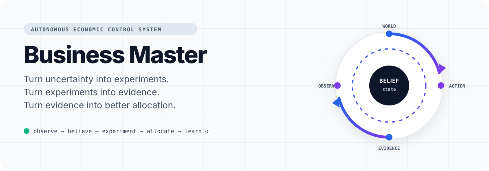

<p align="center">
  <picture>
    <source media="(prefers-color-scheme: dark)" srcset="assets/readme/hero-dark.svg">
    
  </picture>
</p>

<h1 align="center">Business Master</h1>

<p align="center"><strong>Evidence-driven economic experimentation and allocation engine</strong></p>

<p align="center">
Turn uncertainty into experiments.<br>
Turn experiments into evidence.<br>
Turn evidence into better allocation.
</p>

---

Business Master is a standalone economic-control system for deciding **what should be tested, funded, continued, stopped, or scaled** under explicit evidence, uncertainty, risk, capital, and resource constraints.

It does not require an agent runtime, CRM, browser, media stack, workflow engine, or LLM to be useful. Those systems can supply observations or consume typed decisions through replaceable adapters.

Its core question is:

> **What is the highest expected-value next use of the resources currently available, given the evidence we actually have?**

## Core loop

```text
Hypothesis
    ↓
ExperimentContract
    ↓
Observation / Evidence
    ↓
Belief update
    ↓
Evaluation
    ↓
Portfolio + capital policy
    ↓
Decision
    ↺
```

The loop is economically closed only when external evidence can change the next decision. Internal model confidence is not market evidence.

## What Business Master owns

Business Master owns economic semantics and their durable lineage:

- hypotheses and belief state;
- bounded experiment contracts;
- immutable evidence and provenance;
- deterministic economic events and ledger state;
- multidimensional resource semantics;
- family evaluation and readiness;
- portfolio selection and capital authorization;
- decision lineage and bounded continuation.

These objects remain meaningful whether observations arrive from a human, a script, another service, or an autonomous runtime.

## What Business Master does not own

Business Master is intentionally not a generic execution platform. It does not need to own:

- agent identity or orchestration;
- generic task queues or heartbeats;
- browser/scraping implementations;
- CRM, storefront, marketplace, or payment-provider state;
- media generation or rendering;
- LLM inference;
- platform-native telemetry;
- generic workflow automation.

External systems are integrations, not constitutional dependencies.

## Evidence hierarchy

Business Master distinguishes technical success from market response and economic outcome.

| Layer | Question | Examples |
|---|---|---|
| **Operational** | Did the mechanism work? | API accepted action, render completed, job succeeded |
| **Market** | Did reality respond? | click, reply, qualified lead, checkout start |
| **Economic** | Did the response create value? | order, settled revenue, CAC, margin, LTV, MRR |

A technical failure must not falsify a market hypothesis unless technical feasibility is itself under test.

## Deterministic authority first

Different problems belong to different mechanisms.

| Mechanism | Responsibility |
|---|---|
| Deterministic code | accounting, state transitions, idempotency, hard constraints, risk/capital gates |
| Statistical policy | uncertainty, experiment selection, allocation when data supports it |
| AI / humans | semantic research, hypothesis generation, judgment at explicit uncertainty boundaries |

AI may propose actions. It should not silently become the ledger, permission system, or irreversible capital authority.

## Progressive external authority

Integrations should earn authority in three stages:

```text
OBSERVE
  ingest facts, compute evaluations, mutate nothing external
    ↓
SHADOW
  produce counterfactual decisions and compare them with outcomes
    ↓
CONTROL
  emit bounded decisions only for explicitly granted variables
```

This model lets Business Master be useful before it is trusted with external side effects.

## Adaptive optimization

Business Master now exposes a provider-neutral optimization contract.

```text
OptimizationSpec
      │
      ▼
OptimizationEngine
  ┌───────────────┬──────────────┐
  │               │              │
random baseline   Ax adapter   future adapters
  │               │
  └───────┬───────┘
          ▼
  TrialSuggestion
          │
      real outcome
          │
          ▼
  TrialObservation
          │
          ▼
 OptimizationResult
```

The optimizer never becomes the source of truth for Evidence, ledger state, capital authorization, or decision lineage.

The built-in `RandomOptimizationEngine` provides a dependency-free baseline with seeded random search, outcome constraints, best-observed selection, and Pareto-frontier selection.

Optional Meta Ax support uses the modern `ax.api.Client` API:

```bash
uv sync --extra ax
```

See [`docs/OPTIMIZATION.md`](docs/OPTIMIZATION.md).

## Standalone architecture

```text
                    ┌───────────────────────────┐
observations ─────► │      BUSINESS MASTER      │ ─────► typed decisions
                    │                           │
                    │ hypotheses     evidence   │
                    │ beliefs        ledger     │
                    │ experiments    resources  │
                    │ evaluation     capital    │
                    │ portfolio      decisions  │
                    └─────────────┬─────────────┘
                                  │
                         optional engines
                                  │
                    baseline / Meta Ax / future
```

The core is ports-and-adapters by intent: the domain defines economic meaning; external implementations sit at the edges.

## Current status

The repository contains the internal economic substrate built through PR0–PR10 plus the standalone/adaptive-optimization reset:

- hypotheses and beliefs;
- immutable experiment contracts and Evidence;
- multidimensional resources, reservations, usage, and expiry;
- deterministic currency-aware economic ledger;
- evidence-to-belief transitions;
- family-aware evaluation;
- portfolio and capital control;
- persisted bounded autonomous continuation;
- provider-neutral optimization contracts;
- standalone random-search baseline;
- optional Meta Ax adapter.

These prove internal invariants. They do **not** prove economic superiority or a production autonomous business.

After the two planned product stages, development becomes operation-driven: run real experiments, observe bottlenecks, and build only what measured use justifies.

See [`docs/ROADMAP.md`](docs/ROADMAP.md).

## Installation and development

### uv — canonical workflow

Requires `uv` and Python 3.12+.

```bash
git clone https://github.com/AlephCasara/Business-Master.git
cd Business-Master
uv sync

uv run bm --help
uv run bm doctor
uv run pytest
```

To enable the tested Ax adapter:

```bash
uv sync --extra ax
```

Run the standalone golden example:

```bash
uv run python examples/pricing_optimization.py
```

### NixOS

```bash
nix develop
uv sync
uv run bm doctor
```

The Nix shell is a development convenience, not part of the economic domain.

## Engineering principles

- **External reality beats internal confidence.**
- **Technical failure is not market rejection.**
- **Financial arithmetic is deterministic.**
- **Persist economic intent before irreversible effects.**
- **One authority per state.** External integrations reference authoritative state; they do not silently duplicate ownership.
- **Human attention is a scarce resource.**
- **Adapters are replaceable.**
- **Complexity must earn its place through a real workload.**

## Repository structure

```text
src/business_master/
  domain/         economic types and invariants
  policies/       pure decision policies
  controllers/    application coordination
  optimization/   provider-neutral optimization contract + baseline
  adapters/       optional infrastructure/provider integrations
  storage/        PostgreSQL adapters
  ports.py        integration boundaries
  cli.py          thin operator/debug surface
examples/         executable standalone examples
db/migrations/    durable schema evolution
tests/            domain + PostgreSQL + optimizer invariants
docs/             ADRs, architecture, optimization and roadmap
```

The current layout will evolve incrementally; there is no rewrite requirement.

## Documentation authority

Start with:

- [`docs/ARCHITECTURE.md`](docs/ARCHITECTURE.md) — current product boundary and authority model;
- [`docs/OPTIMIZATION.md`](docs/OPTIMIZATION.md) — optimization contract and Ax boundary;
- [`docs/ROADMAP.md`](docs/ROADMAP.md) — implementation sequence;
- [`docs/ADR-0003-resource-vectors-and-reservations.md`](docs/ADR-0003-resource-vectors-and-reservations.md);
- [`docs/ADR-0004-deterministic-economic-ledger.md`](docs/ADR-0004-deterministic-economic-ledger.md);
- [`docs/ADR-0005-evidence-to-belief-updates.md`](docs/ADR-0005-evidence-to-belief-updates.md);
- [`docs/ADR-0007-portfolio-capital-control.md`](docs/ADR-0007-portfolio-capital-control.md);
- [`docs/ADR-0008-autonomous-decision-continuation.md`](docs/ADR-0008-autonomous-decision-continuation.md).

Older strategy, channel, media, and runtime documents remain research/history unless explicitly promoted by an accepted ADR or the current architecture document.

## North star

Business Master is not measured by how many tasks it automates.

It is measured by:

> **how effectively it converts scarce resources into expected and realized economic value while improving the quality of its decisions from evidence.**
